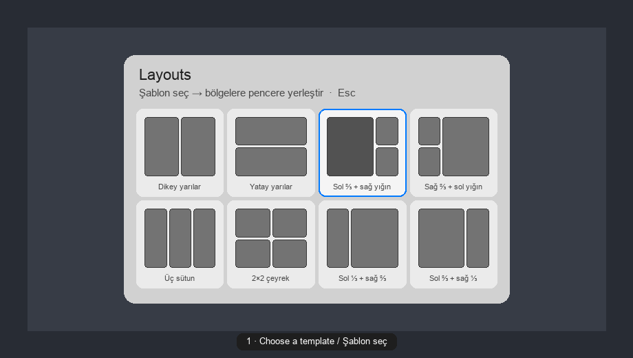
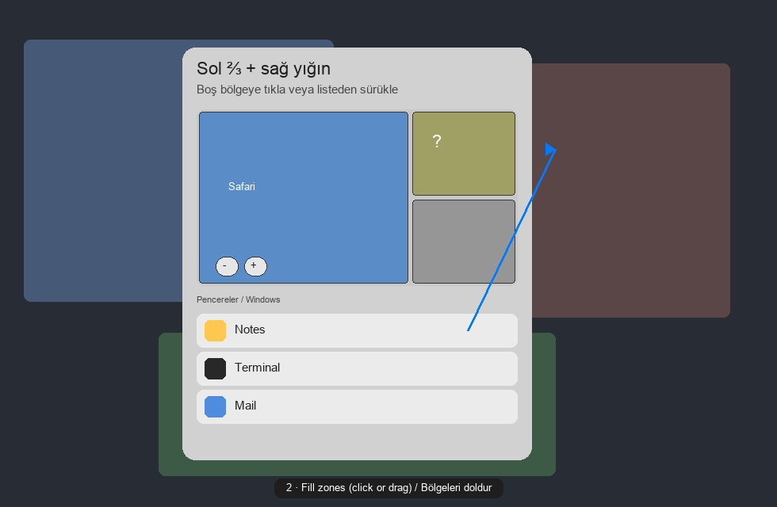
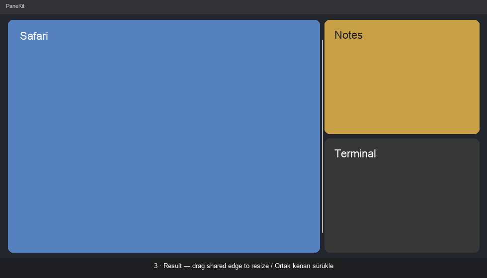

<p align="center">
  <strong>PaneKit</strong><br/>
  <em>Free macOS window manager</em> · <em>Ücretsiz macOS pencere yöneticisi</em>
</p>

<p align="center">
  <a href="#readme-en">English</a> ·
  <a href="#readme-tr">Türkçe</a>
</p>

<p align="center">
  
  
  
  
</p>

---

<a id="readme-en"></a>

# English

**PaneKit** snaps, tiles, and arranges windows with keyboard shortcuts, drag-to-edge, multi-window Layouts, saved Workspaces, and Stash — as a lightweight menu-bar app.

Built with native **Swift + AppKit**. No Electron. No sandbox tax: full Accessibility window control (that also means it cannot ship on the Mac App Store).

## Highlights

| | |
| --- | --- |
| **Snap** | Halves, quarters, thirds, fourths, sixths, maximize, almost-maximize, center, restore |
| **Repeat** | Press again to cycle sizes, then move to the next display |
| **Layouts** | Windows-style templates — assign each zone by click or drag-and-drop (`⌃⌥L`) |
| **Drag** | Narrow edge magnets + shared-edge resize between touching windows |
| **Tile** | Arrange all windows in rows or columns; cycle stacked windows |
| **Pin** | Keep one app in a right sidebar; other snaps use the remaining work area |
| **Workspaces** | Save / restore arrangements; optional restore when a display connects |
| **Stash** | Slide a window off-screen; hover the peek strip to bring it back |

Also: Stage Manager inset, window gaps, Launch at Login, remappable shortcuts, ignore-app list.

## Requirements

- macOS 13 or later  
- [Xcode](https://developer.apple.com/xcode/) 15+ to build from source  

## Install

### Download (Apple Silicon)

1. Grab **[PaneKit-2.0.0-macos-arm64.zip](https://github.com/omersaitsevimli/PaneKit/releases/latest)** from [Releases](https://github.com/omersaitsevimli/PaneKit/releases)
2. Unzip → move `PaneKit.app` to `~/Applications/`
3. First launch: right-click → **Open** (local signing; Gatekeeper may warn once)
4. Grant **Accessibility** to that copy only

Intel Mac? Build from source below (current binary is **arm64**).

### Build from source

**Recommended** (stable path for Accessibility / TCC):

```bash
./scripts/build-release.sh
open ~/Applications/PaneKit.app
```

This installs to `~/Applications/PaneKit.app` and signs with a stable local identity (`PaneKit Local Signing`). Grant Accessibility to **that** copy only.

**Xcode:** open `PaneKit.xcodeproj` → Product → Run. Prefer the same local signing identity so TCC does not reset every rebuild.

**Regenerate project** (optional):

```bash
brew install xcodegen
xcodegen generate
```

## Accessibility

PaneKit needs **Accessibility** permission to move other apps’ windows.

1. System Settings → Privacy & Security → Accessibility  
2. Enable **only** `~/Applications/PaneKit.app`  
3. Remove DerivedData / old entries  
4. Quit PaneKit and reopen it  

Use the menu item **Open Accessibility Settings** if you are unsure which pane to open.

## Layouts

| Trigger | |
| --- | --- |
| Menu bar → **Layouts…** | |
| `⌃⌥L` | |
| Option (⌥) while over the green zoom button | |

**1. Choose a template**

<p align="center">
  
</p>

**2. Fill zones** — click an empty zone or drag a window from the list. Use **− / +** to scale inside a filled zone.

<p align="center">
  
</p>

**3. Done** — windows tile to the template. When two windows share an edge, drag the seam to resize both.

<p align="center">
  
</p>

## Workspaces & Stash

- **Workspaces…** — save current frames, restore later, or on display connect  
- `⌃⌥P` — restore last workspace  
- `⌃⌥`` — stash / unstash focused window  
- `⌃⌥⇧`` — unstash all  

Stashed windows are excluded from tile-all and workspace capture.

## Default shortcuts

Base chord: **Control + Option** (`⌃⌥`). Customize in Settings → Shortcuts.

| Shortcut | Action |
| --- | --- |
| `⌃⌥L` | Layouts |
| `⌃⌥←` `→` `↑` `↓` | Halves |
| `⌃⌥U` `I` `J` `K` | Quarters |
| `⌃⌥↩` | Maximize |
| `⌃⌥=` | Almost maximize |
| `⌃⌥⇧↑` | Maximize height |
| `⌃⌥-` / `⌃⌥⇧=` | Smaller / Larger |
| `⌃⌥C` | Center (keep size) |
| `⌃⌥D` `F` `G` · `E` `R` `T` | Thirds / two-thirds |
| `⌃⌥A` `S` `Z` `X` | Fourths |
| `⌃⌥Q` `W` `O` · `;` `'` `/` | Sixths |
| `⌃⌥,` / `⌃⌥.` | Tile rows / columns |
| `⌃⌥]` / `⌃⌥[` | Cycle stacked windows |
| `⌃⌥⌫` | Restore |
| `⌃⌥⌘←` / `→` | Previous / next display |
| `⌃⌥P` | Restore last workspace |
| `⌃⌥`` / `⌃⌥⇧`` | Stash toggle / unstash all |

## Project layout

```
PaneKit/
├── PaneKit.xcodeproj
├── project.yml          # xcodegen
├── scripts/
├── LICENSE
└── PaneKit/
    ├── App/
    ├── Core/
    ├── Models/
    ├── UI/
    └── Assets.xcassets
```

## Notes

- **LSUIElement** — menu bar only (no Dock icon)  
- Sandbox is off by design (required for cross-app window control)  
- Geometry uses a **work area** (visible frame minus Stage Manager strip, Pin sidebar, then window gap)  
- Maximize ignores window gap so it can sit flush  

## License

[MIT](LICENSE)

<p align="right"><a href="#readme-en">English</a> · <a href="#readme-tr">Türkçe</a></p>

---

<a id="readme-tr"></a>

# Türkçe

**PaneKit**, kısayollar, kenara sürükleme, çoklu pencere Layouts, kayıtlı Workspaces ve Stash ile pencereleri yerleştiren hafif bir menü çubuğu uygulamasıdır.

Yerel **Swift + AppKit**. Electron yok. Accessibility ile tam pencere kontrolü (bu yüzden Mac App Store’a konamaz).

## Öne çıkanlar

| | |
| --- | --- |
| **Snap** | Yarılar, çeyrekler, üçte birler, fourths, sixths, maximize, neredeyse-tam, ortala, restore |
| **Tekrar** | Aynı kısayola tekrar: önce boyut döngüsü, sonra yan monitör |
| **Layouts** | Windows tarzı şablon — bölgelere tıkla veya sürükle-bırak (`⌃⌥L`) |
| **Sürükle** | Dar kenar magneti + yapışık pencerelerde ortak kenar sürükleme |
| **Diz** | Tüm pencereleri satır / sütun ızgarasına diz; yığın pencereleri çevir |
| **Pin** | Bir uygulamayı sağ şeritte tut; diğer snap’ler kalan alanı kullanır |
| **Workspaces** | Düzeni kaydet / yükle; isteğe bağlı ekran bağlanınca restore |
| **Stash** | Pencereyi kenara gizle; şeride imleç getirince geri aç |

Ayrıca: Stage Manager boşluğu, pencere gap’i, açılışta başlat, özelleştirilebilir kısayollar, yok sayılan uygulamalar.

## Gereksinimler

- macOS 13 veya üzeri  
- Kaynak derlemek için [Xcode](https://developer.apple.com/xcode/) 15+  

## Kurulum

### İndir (Apple Silicon)

1. [Releases](https://github.com/omersaitsevimli/PaneKit/releases) sayfasından **[PaneKit-2.0.0-macos-arm64.zip](https://github.com/omersaitsevimli/PaneKit/releases/latest)** indir
2. Zip’i aç → `PaneKit.app` dosyasını `~/Applications/` altına taşı
3. İlk açılış: sağ tık → **Aç** (yerel imza; Gatekeeper bir kez uyarabilir)
4. Erişilebilirlik iznini **yalnızca bu kopyaya** ver

Intel Mac? Aşağıdan kaynak derle (şu anki binary **arm64**).

### Kaynaktan derle

**Önerilen** (Accessibility / TCC için sabit yol):

```bash
./scripts/build-release.sh
open ~/Applications/PaneKit.app
```

Uygulama `~/Applications/PaneKit.app` altına kurulur ve `PaneKit Local Signing` ile imzalanır. İzni **yalnızca bu kopyaya** verin.

**Xcode:** `PaneKit.xcodeproj` → Product → Run. Her rebuild’de TCC sıfırlanmasın diye aynı yerel imzayı kullanın.

**Projeyi yeniden üretmek** (isteğe bağlı):

```bash
brew install xcodegen
xcodegen generate
```

## Erişilebilirlik izni

PaneKit’in diğer uygulamaların pencerelerini taşıması için **Erişilebilirlik** (Accessibility) gerekir.

1. Sistem Ayarları → Gizlilik ve Güvenlik → Erişilebilirlik  
   (veya “Yardımcı uygulamaların bilgisayarı denetlemesine izin ver”)  
2. Yalnızca `~/Applications/PaneKit.app` açık olsun  
3. DerivedData / eski satırları silin  
4. PaneKit’i kapatıp yeniden açın  

Menüdeki **Erişilebilirlik Ayarlarını Aç** doğru panoyu açar.

## Layouts

| Tetikleyici | |
| --- | --- |
| Menü çubuğu → **Layouts…** | |
| `⌃⌥L` | |
| Yeşil zoom düğmesinin üzerinde ⌥ | |

**1. Şablon seç**

<p align="center">
  
</p>

**2. Bölgeleri doldur** — boş bölgeye tıkla veya listeden sürükle. Dolu bölgede **− / +** ile ölçekle.

<p align="center">
  
</p>

**3. Sonuç** — pencereler şablona yerleşir. Ortak kenarı sürükleyerek iki pencereyi birden boyutlandırabilirsin.

<p align="center">
  
</p>

## Workspaces ve Stash

- **Workspaces…** — mevcut çerçeveleri kaydet, sonra yükle veya ekran bağlanınca uygula  
- `⌃⌥P` — son workspace  
- `⌃⌥`` — odak penceresini stash / geri al  
- `⌃⌥⇧`` — tüm stash’leri aç  

Stash’li pencereler tile-all ve workspace kaydına dahil edilmez.

## Varsayılan kısayollar

Taban: **Control + Option** (`⌃⌥`). Settings → Shortcuts’tan değiştirilebilir.

| Kısayol | İşlem |
| --- | --- |
| `⌃⌥L` | Layouts |
| `⌃⌥←` `→` `↑` `↓` | Yarılar |
| `⌃⌥U` `I` `J` `K` | Çeyrekler |
| `⌃⌥↩` | Maximize |
| `⌃⌥=` | Neredeyse tam |
| `⌃⌥⇧↑` | Yüksekliği maksimize |
| `⌃⌥-` / `⌃⌥⇧=` | Küçült / büyüt |
| `⌃⌥C` | Ortala (boyutu korur) |
| `⌃⌥D` `F` `G` · `E` `R` `T` | Üçte bir / üçte iki |
| `⌃⌥A` `S` `Z` `X` | Fourths |
| `⌃⌥Q` `W` `O` · `;` `'` `/` | Sixths |
| `⌃⌥,` / `⌃⌥.` | Satırlara / sütunlara diz |
| `⌃⌥]` / `⌃⌥[` | Yığın pencereleri çevir |
| `⌃⌥⌫` | Önceki boyuta dön |
| `⌃⌥⌘←` / `→` | Önceki / sonraki ekran |
| `⌃⌥P` | Son workspace’i yükle |
| `⌃⌥`` / `⌃⌥⇧`` | Stash aç-kapa / tümünü aç |

## Proje yapısı

```
PaneKit/
├── PaneKit.xcodeproj
├── project.yml          # xcodegen
├── scripts/
├── LICENSE
└── PaneKit/
    ├── App/
    ├── Core/
    ├── Models/
    ├── UI/
    └── Assets.xcassets
```

## Notlar

- **LSUIElement** — yalnızca menü çubuğu (Dock’ta yok)  
- Sandbox kapalı (diğer uygulamaların pencereleri için gerekli)  
- Geometri **work area** üzerinden hesaplanır (Stage Manager, Pin, gap)  
- Maximize, gap’i yok sayarak kenara yapışır  

## Lisans

[MIT](LICENSE)

<p align="right"><a href="#readme-en">English</a> · <a href="#readme-tr">Türkçe</a></p>
