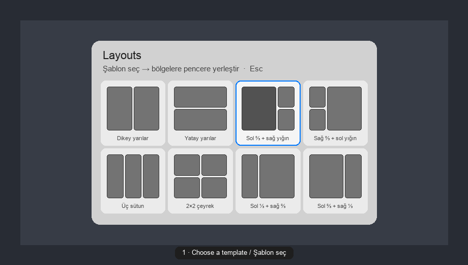
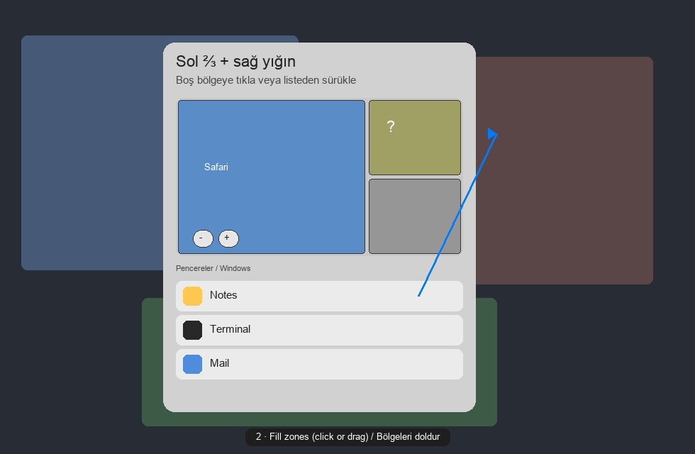
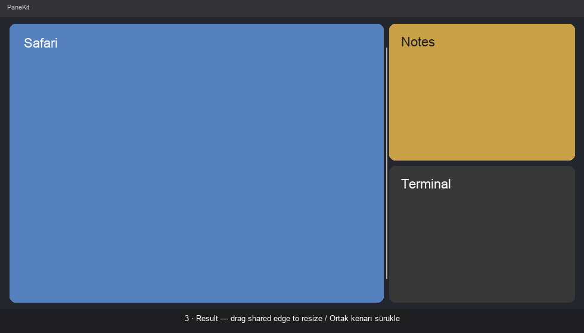

# Layouts (English)

Windows 11–style multi-window templates. Pick a layout, fill each zone with a window.

## Open

| Trigger | |
| --- | --- |
| Menu bar → **Layouts…** | |
| `⌃⌥L` | |
| Hold **⌥** over the green zoom button | |

Press `Esc` to dismiss.

## 1. Choose a template

Templates include vertical/horizontal halves, ⅔ + stack, three columns, 2×2 quarters, and ⅓ / ⅔ splits.

## 2. Fill zones

- Click an empty zone (focused window or first candidate)  
- Or **drag** from the candidate list  
- Use **− / +** to scale inside a filled zone  

## 3. Result

When zones share an edge, drag the seam to resize both (if shared-edge drag is enabled).

## Notes

Layouts respect **work area** (Stage Manager inset, Pin sidebar, window gap).
