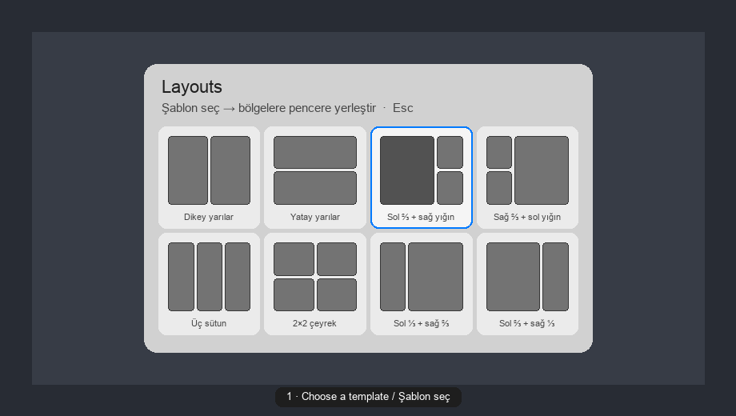
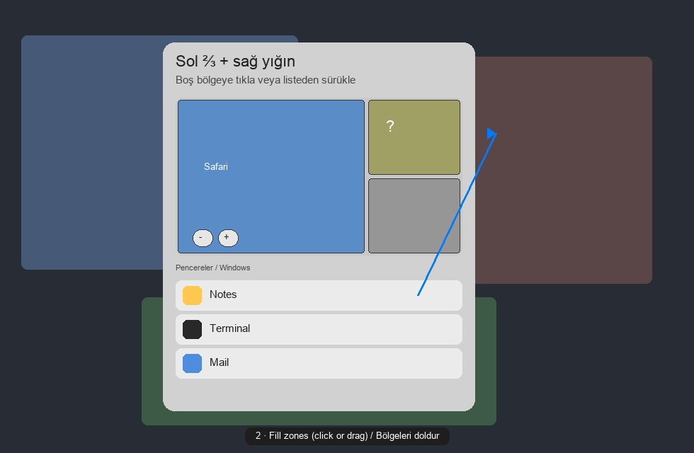
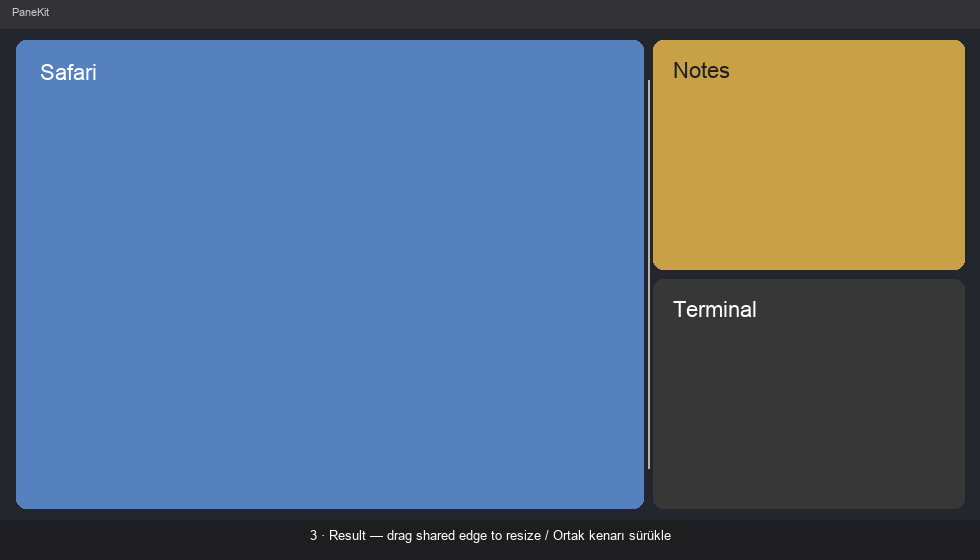

# Layouts

Windows 11 tarzı çoklu pencere şablonları. Bir şablon seçersin, her bölgeye pencere yerleştirirsin.

## Nasıl açılır?

| Tetikleyici | |
| --- | --- |
| Menü çubuğu → **Layouts…** | |
| `⌃⌥L` | |
| Pencerenin **yeşil zoom** düğmesinin üzerinde **⌥** (Option) basılı tut | |

`Esc` ile kapatılır.

## Adım 1 — Şablon seç

Hazır şablonlar:

- Dikey / yatay yarılar  
- Sol ⅔ + sağ yığın (ve aynası)  
- Üç sütun  
- 2×2 çeyrek  
- Sol ⅓ + sağ ⅔ (ve aynası)  

## Adım 2 — Bölgeleri doldur

1. İlk boş bölgeye tıkla → odak penceresi (veya listedeki ilk aday) yerleşir  
2. Sonraki bölgeler için listeden **tıkla** veya **sürükle-bırak**  
3. Dolu bölgede **− / +** ile zone içinde ölçekle  
4. Yanlış yerleştirdiysen bölgeye tekrar tıklayıp başka pencere seç  

Aday listesi görünür, küçültülmemiş, yeniden boyutlandırılabilir pencereleri gösterir. Erişilebilirlik kapalıysa listeden izin isteyebilirsin.

## Adım 3 — Sonuç

Tüm bölgeler dolunca pencereler work area’ya oturur. İki pencere kenar paylaşıyorsa **ortak çizgiyi sürükleyerek** ikisini birden boyutlandırabilirsin (Settings’te “Drag shared edge” açıksa).

## İpuçları

- Layouts, Pin şeridi ve Stage Manager inset’ini **work area** hesabına katar  
- Window gap açıksa bölgeler arasında boşluk bırakılır  
- Stubborn uygulamalar (bazı tarayıcılar) ilk yerleşimde biraz direnebilir; PaneKit kısa bir yeniden deneme yapar  

## İlgili

- [Özellikler](Özellikler) — ortak kenar sürükleme  
- [Kısayollar](Kısayollar)  
